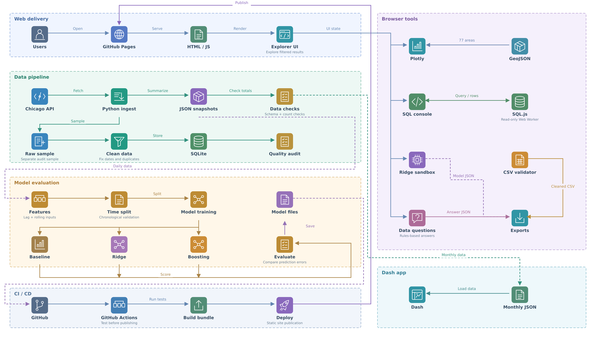

# Chicago Crime Explorer

An end-to-end public-data portfolio: Python preparation, auditable SQL aggregates, interactive reporting, and time-based forecasting evaluation.

**Live demo:** https://divyamistry2224.github.io/Chicago-Crime-Explorer/

## What is actually implemented

| Area | Evidence |
|---|---|
| Data engineering | Socrata extraction with bounded pagination, retries, atomic writes; record normalization, duplicate handling, quarantine, checksums, SQLite silver table and gold monthly view |
| Analytics / BI | Shared year, month, offense, community, arrest and domestic filters; 77-area linked map; Plotly time series; heatmap; community comparisons; CSV and PNG exports; shareable filtered URLs |
| Data science / ML | Lagged and shifted rolling features; weekly naive, ridge and gradient boosting; four chronological quarterly evaluation folds; MAE/RMSE/WAPE; residuals and model card |
| Applied analytics interface | Deterministic question intent routing with calculation trace, explicit scope and source attribution; no LLM/API or claimed generative AI |
| Python visualization | Runnable Plotly Dash companion with linked map, monthly series, filters, KPI summaries and download callbacks |
| Data quality | Full aggregate reconciliation; separate 10,000-record sample audit; local CSV validator; tests of data contracts and leakage prevention |

## Chicago In Focus (version 4)

A city-atlas redesign with Chicago flag accents, lake-blue maps, condensed editorial typography and an overview centered on the 77-community map. The change lens compares 2025 with 2024 using identical month, offense and flag filters; hover reveals exact counts and percentage change. Community discovery and dispatch shortcuts connect the map to existing temporal, comparison and engineering workspaces.

## Interactive workspaces

Each workspace now opens with its own task, controls and visuals. Overview KPIs and global introductory content do not repeat on the engineering, modeling, assistant, project or methods pages. Overview, time and community pages retain separate filter states; the temporal page deliberately uses only year/offense/month controls.

- **Overview:** investigation shortcuts, linked maps and charts, browser-local saved briefings, and exportable analysis notes.
- **Time studio:** monthly scrubber, play/pause, clickable month rail and year-context chart, and offense composition that changes with the selected month. Playback ignores the month-window filter by design and uses the full selected year and offense; this is labeled.
- **Community comparison:** independent A/B selectors, swap control, counts and arrest/domestic proportions, monthly curves and grouped offense profiles. No safety or population-rate ranking.
- **Engineering playground:** editable synthetic fixtures with configurable date parsing, category normalization, ID deduplication and coordinate nulling. Every row receives a transformation audit; turning rules off can retain invalid data and is visibly labeled. Separate from official totals.
- **SQL challenges:** compare a single numeric query result against source-derived expected totals. A matching result is not proof of a correctly reasoned query.
- **Live model experiment:** JavaScript ridge regression with training-only scaling; configurable training cutoff, regularization and evaluation window. Includes a weekly baseline, actual predictions, standardized coefficients and a downloadable artifact. Repeated tuning is exploratory, not an untouched-test evaluation. Browser coefficients/predictions are checked against the Python scikit-learn reference.
- **Question builder:** explicit intent/offense/year selection, calculation trace and session history; deterministic, not a language model.
- **Statistics workbench:** synthetic sample-size/proportion controls that recompute Wilson intervals.
- **Project studio:** five-stop guided walkthrough, professional role lenses and source download.
- **Navigation:** Ctrl/Cmd+K opens a searchable page launcher. Playback stops on navigation or when the document is hidden. Reduced-motion preferences disable page transitions.

Functional tests exercise these interactions. Actual browser visual verification remains unavailable in this session.

## Architecture



[Download 8K PNG](docs/assets/architecture-8k.png) · [Editable structure](docs/assets/architecture.drawio)

The public demo uses static HTML/JavaScript, vendored Plotly.js and SQLite WebAssembly. It serves bundled aggregate/model artifacts without a running database, ML service, or Google Cloud billing account. The Python Dash companion is included in the source and runs locally; it is not the runtime hosting the public URL.

## Data coverage and provenance

- City dataset `ijzp-q8t2`, incident dates January 1, 2024–December 31, 2025; retrieved November 12, 2026.
- 497,909 incident records: 259,687 in 2024 and 238,222 in 2025.
- Monthly cube: 57,340 cells; temporal cube: 58,569 cells; daily city series: 731 days. All totals reconcile for the bundled snapshot.
- Kaggle listing: https://www.kaggle.com/datasets/chicago/chicago-crime . This is a BigQuery-backed listing. The demo independently retrieves the original City of Chicago source, not a Kaggle CSV or the user's former app.
- Boundaries: City of Chicago `igwz-8jzy` GeoJSON; 77 community areas.
- Raw sample: 10,000 rows returned by the source API within the date window; a convenience snapshot, not a representative sample. It is not used to estimate city totals. It contains public source incident IDs and published coordinates; no names, addresses, or case narratives are included.
- Of the sample records, 2,727 have missing coordinates and 320 have unknown community codes. All 10,000 have accepted dates/IDs in this run. No duplicate IDs or quarantines were observed; malformed fixture tests exercise these paths. Missing coordinates are retained as nulls rather than invented.
- Publishers can revise reports. The source cautions against comparing classifications over time. Treat temporal differences as descriptive.

## Run the Python application

Python 3.11+ is recommended.

```sh
python -m venv .venv
source .venv/bin/activate
pip install -r requirements.txt
python -m unittest discover -s tests -v
python pipeline/prepare.py
python pipeline/models.py
python dash_app/app.py
```


## Reproduce or refresh the pipeline

Bundled inputs work offline. `python pipeline/prepare.py` rebuilds the sample warehouse and quality report. `python pipeline/models.py` rebuilds model artifacts from the daily snapshot. To fetch revised source data, run `python pipeline/extract.py` first. API availability and revisions may affect results. Extraction has a fixed 2024–2025 scope and a configurable raw sample size; it is not a CDC/streaming pipeline.

Prepare your own CSV with Chicago-style columns:

```sh
python pipeline/prepare.py --input /path/to/incidents.csv --output data/custom
```

CSV dates accept ISO timestamps and `MM/DD/YYYY hh:mm:ss AM/PM`. Required pipeline columns include ID and Date; unknown categories, communities, flags, and locations are explicitly marked. Browser preview requires Date and Primary Type; IDs are optional, and duplicate detection only works when IDs are present. A custom preparation run overwrites `dist/quality.json`; restore the bundled report or rebuild with the bundled sample before publishing a canonical snapshot.

SQLite quality sample warehouse is `data/warehouse.sqlite` (generated, not source-controlled). The browser SQL sandbox independently loads full monthly aggregate cells in `incidents(year, month, primary_type, community_area, arrest, domestic, n)` and is read-only. Always use `SUM(n)`, not `COUNT(*)`, to count source incidents. Web-worker execution has a 10-second limit and 1,000-row result cap.

## Model protocol

Target: next-day citywide incident counts, all offenses. Initial training is in 2024 after a 28-day warm-up. Evaluation uses four 2025 calendar quarters; each fold refits on all prior available dates. Actual prior-day counts update lag features each day within a fold. This is one-day-ahead rolling evaluation, not a recursively forecast full year.

Features: lags 1, 7, 14 and 28; means of preceding 7 and 28 days; cyclic weekday and annual calendar encodings; elapsed time. Scaler is fit only on training rows. No target-day arrest, domestic or location outcomes are used.

Models have fixed settings: weekly naive (`y[t-7]`); StandardScaler + Ridge(alpha=10); HistGradientBoosting(max_iter=100, max_leaf_nodes=7, l2_regularization=10, learning_rate=0.05, random_state=42). No hyperparameter search is claimed. See `dist/models.json` for parameters, folds, prediction records, metrics, package versions and source checksum.

Bundled benchmark (365 evaluation days):

| Model | MAE | RMSE | WAPE |
|---|---:|---:|---:|
| Weekly naive | 59.99 | 80.22 | 9.19% |
| Ridge regression | 39.95 | 52.75 | 6.12% |
| Gradient boosting | 43.23 | 56.54 | 6.62% |

These are retrospective results on revised incident-date data. Counts available the following day in real operations may be incomplete; no historical as-of snapshots exist here. The apparent winner is descriptive, not a guarantee. No online inference endpoint, model monitoring service, externally validated deployment, or real-time refresh is implemented.

Anomaly screening uses current count minus the preceding 28-day mean, divided by preceding sample standard deviation. It is a descriptive rule, not a classifier, cause detector, or corrected hypothesis test.

## Interpretation

Citywide per-100,000 views optionally use a fixed 2020 census population of 2,746,388; they are not contemporaneous population estimates. No community population-adjusted rates or individual safety scores are shown. Arrest proportions use Wilson intervals as a binomial-model illustration and are not conviction/clearance rates. Full methods are on the public site.

## Validation

- Unit tests: normalization, date formats, missing/invalid coordinates, unknown booleans, quarantine/dedup reconciliation, SQLite gold totals, lag-feature leakage and metric formulas.
- Dashboard DOM tests (Node 20+, `npm install && npm test`; JSDOM with chart calls stubbed, not browser rendering): filter combinations, share-state restoration, category/area selection, year/month constraints, CSV parsing and downloads, question routing and output escaping.
- SQLite wasm tests: real SUM(n) totals, temporal grouping, and read-only rejection.
- Dash tests: HTTP/layout responses, callback figures and filtered totals.
- Browser visual QA was unavailable in this managed session; responsive CSS and actual browser rendering require a final manual review.

## Licenses

City of Chicago data is provided under the source publisher's terms and without warranty. Kaggle's listing labels the dataset CC0; consult original terms before redistribution. Plotly.js is MIT; SQL.js is MIT. Vendored packages retain license headers; see `THIRD_PARTY.md`.

## GitHub Pages deployment

The `Deploy GitHub Pages` workflow uploads `dist/` and deploys it after the project checks pass. Relative asset paths support the repository subdirectory. Python Dash runs separately; GitHub Pages serves only the static browser application.
